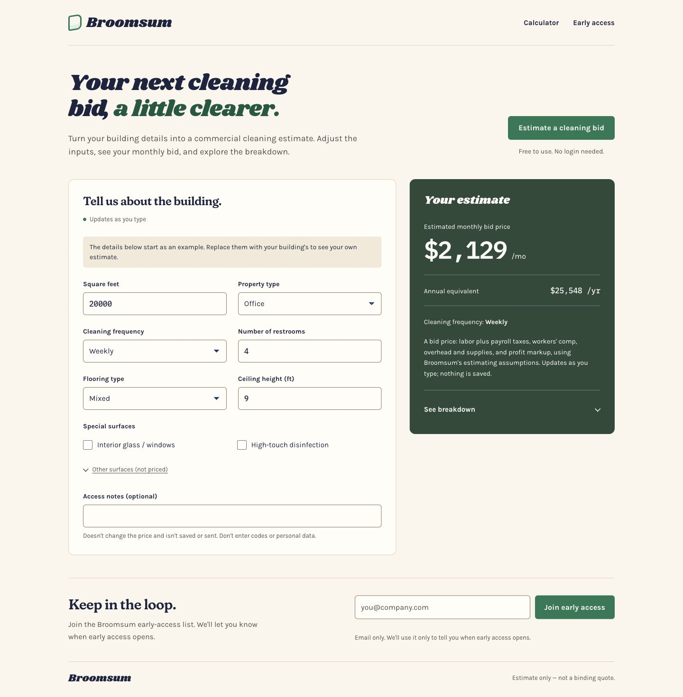
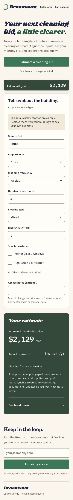

# Broomsum

**Commercial-cleaning estimation · Website live · Application in development**

Broomsum is a founder-led product for helping commercial cleaning businesses turn building details into clearer estimates. The public website includes a calculator and early-access signup. The full application is still in development and has not launched.

**[Visit the website](https://broomsum.pages.dev/)** · [Read the case study](docs/CASE_STUDY.md) · [Explore the architecture](docs/ARCHITECTURE.md)



*Public website preview using seeded example inputs. The displayed estimate is a demonstration, not a customer quote.*

## Project at a glance

| Area | Current state |
|---|---|
| Public website | Live, with responsive calculator and early-access signup |
| Full application | In development; not publicly launched |
| Frontend | F#, Fable, Feliz/React, Vite, CSS |
| Application development | TypeScript, Supabase/PostgreSQL and Edge Functions in the private project |
| This repository | Selected website code samples, executable checks, screenshots and a case study |

## What this work demonstrates

- **Product scope:** a focused estimating experience built around building details and an understandable result.
- **Input design:** explicit valid, incomplete and invalid states, so partially typed numbers do not silently become estimates.
- **Reliable feedback:** an early-access form only reports success after a positive server confirmation.
- **Testable code:** pure F# functions separate user-interface behavior from network requests and rendering.
- **Responsive delivery:** a live website with desktop and mobile layouts.

The project uses an AI-assisted development workflow. Product decisions, generated changes and verification results are reviewed as part of that process.

## Explore the code

These small modules are extracted from the website implementation, with namespaces and comments adapted for this portfolio. They preserve the selected decision logic without requiring the private application.

| Sample | What to look for |
|---|---|
| [NumberInput.fs](samples/NumberInput.fs) | Strict numeric grammar, incomplete typing states, field limits and safe whole-dollar formatting |
| [SignupContract.fs](samples/SignupContract.fs) | Explicit success criteria and separate handling of an invalid email versus an unconfirmed submission |
| [Run.fsx](tests/Run.fsx) | Executable cases for accepted input, ambiguous formats, boundaries, malformed replies and failures |

### Run the checks

Install the [.NET 8 SDK](https://dotnet.microsoft.com/download/dotnet/8.0), then run from this repository's root:

```sh
dotnet fsi tests/Run.fsx
```

The script prints the result of each case and exits with a nonzero status if any case fails. It requires no API keys, database, signup service or external test package. GitHub Actions runs the same command.

[Verification scope and limitations](docs/VERIFICATION.md)

## Design and implementation decisions

**Keep calculations deterministic.** The project separates numerical estimating logic from explanatory text. The two public samples here focus on input and response handling; the complete estimation engine remains in the private application.

**Treat unfinished input as a normal state.** A value such as `35,` can be a reasonable intermediate keystroke. The parser preserves that distinction, while finalizing the field produces a clear validation result.

**Require evidence before showing success.** A successful HTTP status alone does not confirm a signup. The classifier also checks the response body, protecting against empty, contradictory or malformed replies.

**State delivery status clearly.** The website is available now. Accounts, saved estimates and the broader application experience belong to ongoing application development.

<details>
<summary>View the mobile website</summary>



</details>

## About this portfolio

Maintained by [bennyfranklin44](https://github.com/bennyfranklin44). This is a curated project showcase with independent history. It is not the full application source or an application launch announcement.
