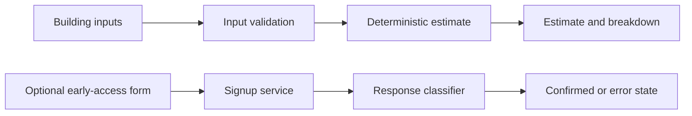
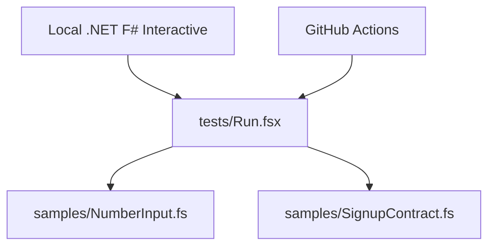

# Architecture overview

## Live website

The website uses F# compiled to JavaScript through Fable, Feliz/React for the interface and Vite for the web build. Static assets are hosted on Cloudflare Pages.

The numerical path runs in the website. The signup flow is a separate network operation. The public portfolio includes the input-validation and response-classification components, not the full website or estimating engine.

## Application in development

The private project contains work on a broader application using Supabase/PostgreSQL and TypeScript Edge Functions. The development architecture separates browser interactions, server validation and persistence. The full application has not launched.

## Sample boundaries

`NumberInput` accepts text plus a field specification and returns a typed result. It also exposes a finalization step, an error-message function and a whole-dollar formatter. It has no network or persistence dependency.

`SignupContract` accepts a status code and a loosely decoded response. It produces either confirmed success, a field-specific email rejection or a general unconfirmed result. The module does not parse raw HTTP, store addresses or perform requests.

The test runner executes the same public sample files a reviewer can read. The portfolio does not require access to the private repository or a cloud service.
